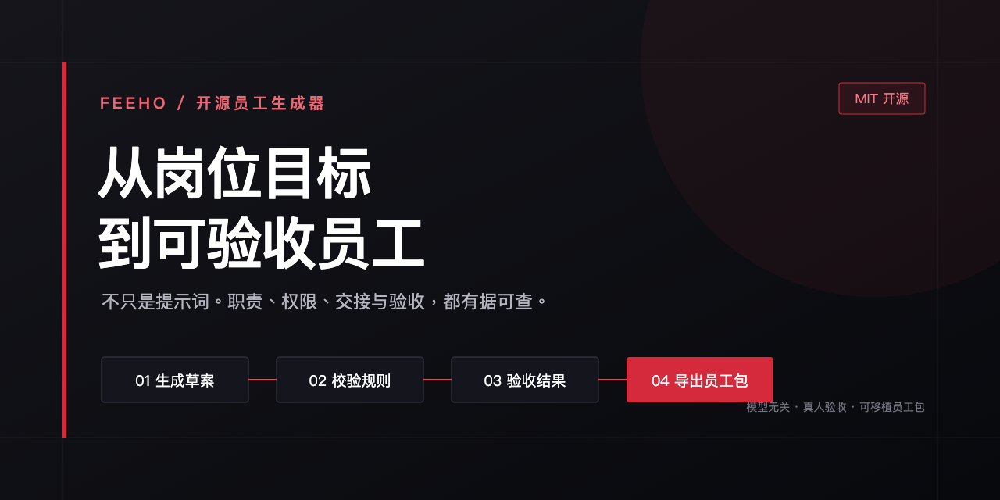
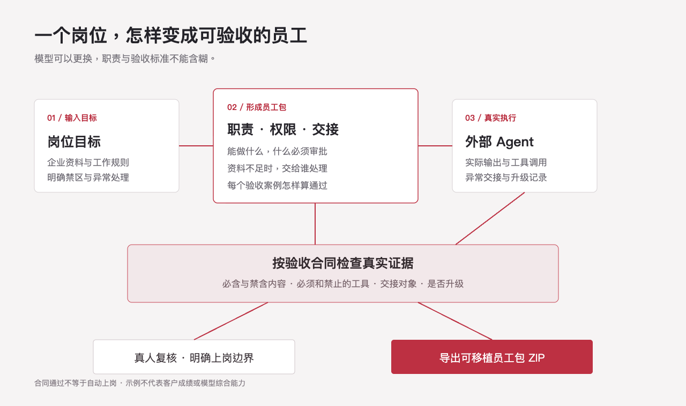
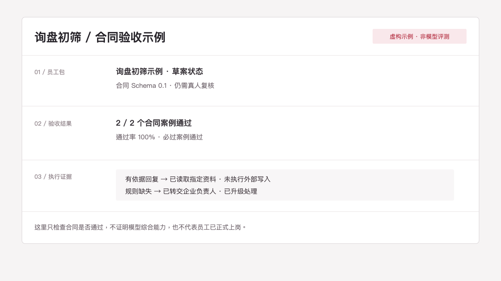

# FEEHO员工生成器

**把岗位目标整理成可移植员工包，用明确权限和验收合同检查真实 Agent 结果。**

[English README](docs/README.en.md)

## 这是什么

这是一个模型无关的开源员工合同与权限工具，包含：

- 通用岗位草案脚手架 `draft`
- 中文需求到组织与权限参数的确定性编译 `configure`
- 只读组织 Diff 预览 `propose`、不可变版本比较 `diff` 和版本列表 `history`
- 下一次执行路径计算 `simulate`，不冒充模型运行
- 员工包 Schema 与规则校验 `validate`
- Claude Code `PreToolUse` 工具权限适配器 `cc`
- Agent 外部终端的一次性人工授权 `approve`
- 外部 Agent 结果验收运行器 `test`
- 可移植 ZIP 导出 `export`

[用 Claude Code 做对照测试](docs/CC_COMPARISON.zh-CN.md)

**一句话只能生成草案。**企业资料适配、权限边界、交接规则、外部结果与真人验收完成后，才可能成为正式员工。

## 快速开始

需要 Python 3.10+：

```bash
git clone https://github.com/FEEHOAI/feeho-employee.git
cd feeho-employee
python3 -m venv .venv
source .venv/bin/activate
pip install -e .
```

运行自带的虚构示例：

```bash
feeho validate examples/inquiry-triage
feeho test examples/inquiry-triage \
  --results examples/sample-results.json \
  --report /tmp/feeho-report.json
feeho export examples/inquiry-triage --output /tmp/inquiry-triage.zip
```

生成一个能直接看出权限变化的内容运营员工：

```bash
feeho draft \
  --role "内容运营经理" \
  --objective "拆解一周内容计划，安排选题、写稿和审核，发布由负责人决定。" \
  --request "可以写稿和审核，不能自行发布，发布前必须由负责人批准，标题夸大必须退回重写，不能增加预算。" \
  --output /tmp/content-manager

feeho cc /tmp/content-manager
```

终端会直接显示“允许写稿、发布需真人审批、禁止增加预算”的参数 Diff，并生成 Claude Code 工具权限适配器。

先让 CC 只读预览组织与权限变化：

```bash
feeho propose /tmp/content-manager \
  --request "周三用户案例先由审核员工检查，经理复核后才能交给我批准。"
```

`propose` 会显示岗位分工、任务顺序、审批路径、验收合同和下一次执行，**不会修改员工包**。决定应用后，由真人在 Agent 外部运行：

```bash
feeho configure /tmp/content-manager \
  --request "周三用户案例先由审核员工检查，经理复核后才能交给我批准。"

feeho history /tmp/content-manager
feeho diff /tmp/content-manager --from 2 --to 3
feeho simulate /tmp/content-manager
```

每次应用都生成不可变 `versions/vNNN.json`。规则真实变化后，旧验收失效；没有实际变化时，不使验收失效。完整 CC 对照、一次性授权和审计测试见 [Claude Code 对照指南](docs/CC_COMPARISON.zh-CN.md)。

## 员工包怎样工作



## 员工包结构

```text
employee.yaml       身份、岗位目标、draft/accepted 状态
role.md             岗位职责与企业规则
instructions.md     工作规则
permissions.yaml    允许、需审批、禁止的动作
organization.yaml   岗位职责、任务顺序与审批路径
versions/           不可变需求版本与完整合同快照
model-policy.yaml   模型策略，不保存凭证
handoffs.yaml       异常、缺口和超时的交接对象
evals/cases.yaml    输入与输出/工具验收合同
acceptance.yaml     通过率、必过案例和真人复核
```

## 验收运行器怎样工作

CLI 不调用模型。你用任意 Agent 运行时执行 `evals/cases.yaml`，再把每个 case 的真实输出、工具调用、交接和升级情况写成 JSON 传给 `feeho test`。

v0.3 支持：输出必含/禁含、必须/禁止工具、指定交接对象、是否必须升级，以及 `required_sequence` 执行顺序验收。缺结果会失败，不会把“文件格式正确”冒充“任务通过”。

通过报告不会自动把 `draft` 改成 `accepted`；正式上岗仍需人工验收。

## 当前边界

v0.3 不提供托管模型、自主 Agent 运行时、多员工组织调度、长期飞书/钉钉/企微协作或完整行业岗位包。Claude Code Hook 是工具策略层，不是操作系统沙箱；通用工具名映射不能替代真实企业 MCP 的显式权限配置。

这些组织与企业能力属于独立私有商业产品，见 [COMMERCIAL.md](COMMERCIAL.md)。

## 图文示例：询盘初筛

虚构规则要求：依据已提供资料分级、注明出处，并在企业规则缺失时转交人工。

验收器会实际检查两条合同：

1. **有依据的回复**：必须调用资料读取工具，不得执行外部写入，不得升级。
2. **规则缺失**：必须说明需要人工确认，必须转交 `human-owner`，必须升级。



这张图是随仓库样例结果制作的说明图，不是在线服务截图、模型评测或客户成绩。你可以用上面的 Quick start 命令实际生成 JSON 报告。

## 测试与贡献

```bash
python -m unittest discover -s tests -v
```

贡献流程见 [CONTRIBUTING.md](CONTRIBUTING.md)，安全问题见 [SECURITY.md](SECURITY.md)。不要提交密钥、客户资料或私有企业内容。

## 许可证与商业授权

开源核心采用 [MIT License](LICENSE)，**核心本身允许商业使用，不需要额外向 FEEHO 申请商用授权**。MIT 允许商业使用、修改和分发，使用者需保留版权和许可声明。

**企业产品与持续服务需要单独商业授权**：多员工组织调度、企业审批审计、长期飞书/钉钉/企微协作、行业岗位包、私有化部署和持续交付服务。这些内容不在本开源仓库。

企业合同不会收回或限制核心已经授予的 MIT 权利，详见 [COMMERCIAL.md](COMMERCIAL.md)。
